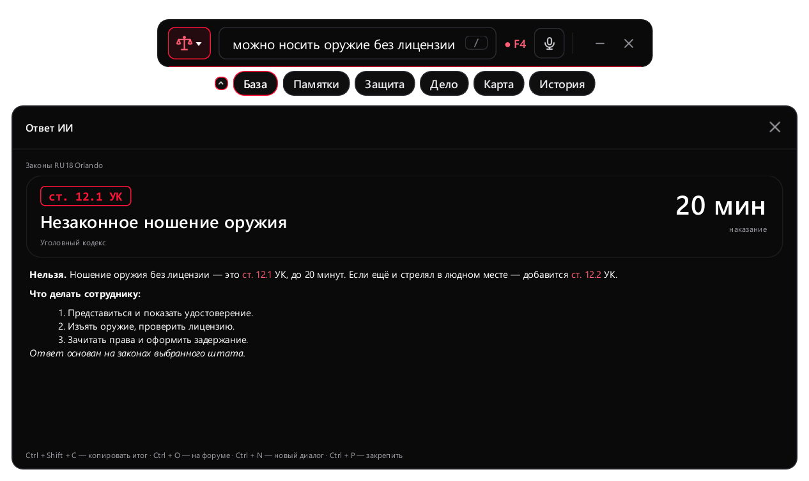
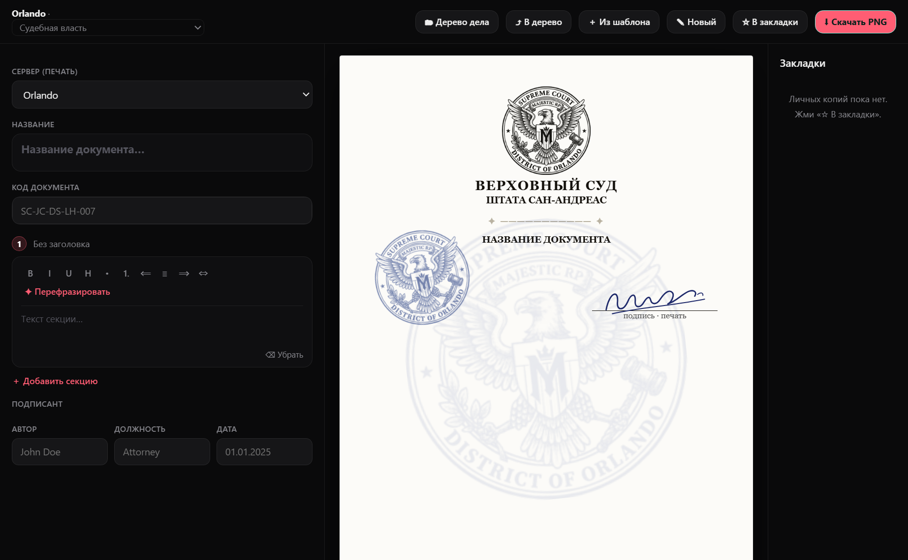
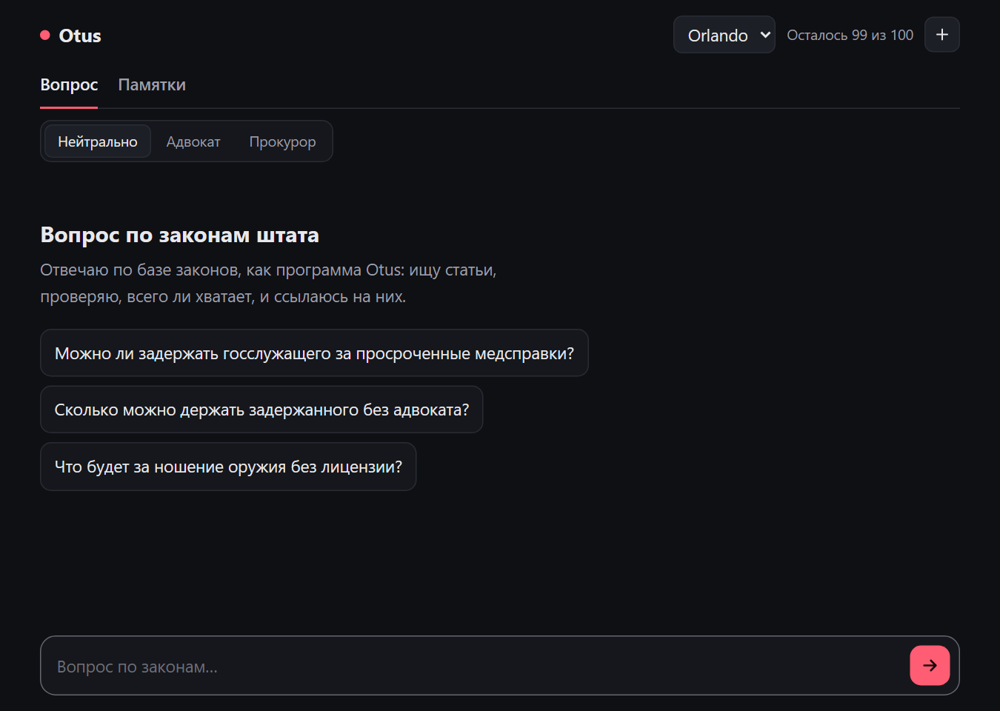
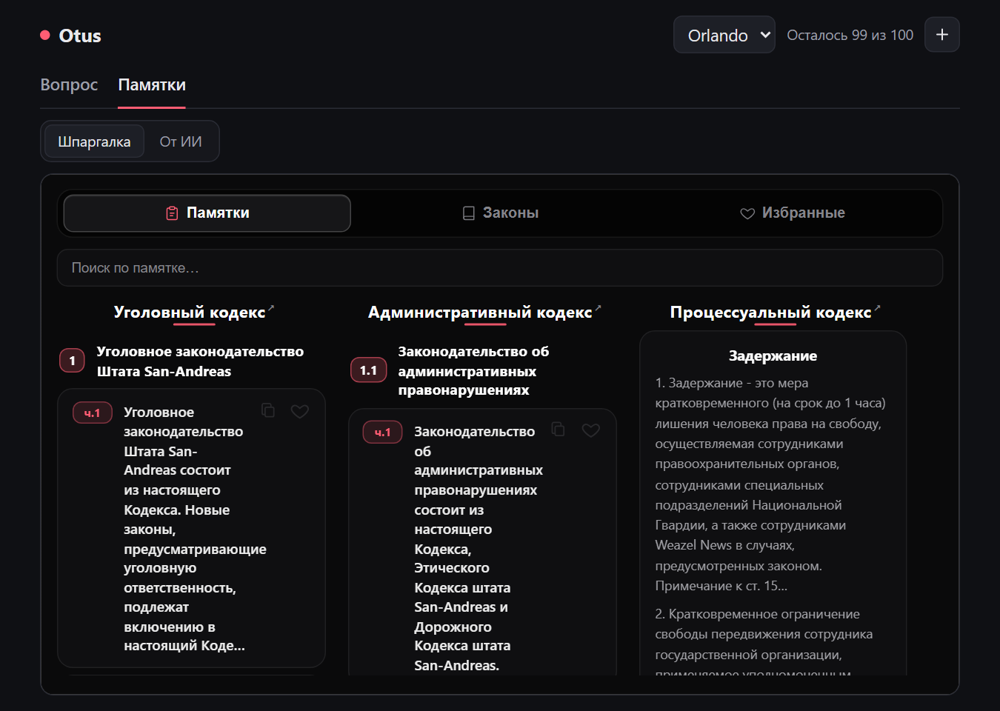

# 🦉 Otus SKDA

**ИИ-помощник по законам GTA 5 RP прямо поверх игры** — для семьи **SKDA** на Majestic RP

### [⬇️ Скачать последнюю версию](https://github.com/funnynewguy001/Otus-SKDA/releases/latest)

---

Спросил голосом или текстом — получил ответ по законам **своего штата**, не сворачивая игру.
Otus знает законы, уставы ведомств и правила проекта, даёт ссылки на статьи и помогает с документами.
**Встроенный ИИ — бесплатно и без ключей:** вошёл через Discord, и всё работает.

## ✨ Возможности

- **Встроенный ИИ без ключей** — вошёл через Discord, и Otus отвечает. Свой ИИ (Gemini, GigaChat и другие) — по желанию, одним рычажком.
- **Ответ по законам штата** — со ссылками на статьи: клик, и статья открыта. На «можно ли…» первой строкой: *Можно / Нельзя / Зависит*.
- **Голосом, прямо в игре** — по зажатой клавише (по умолчанию F4).
- **Памятки** — шпаргалка отыгровок /me и /do (клик, и строка в буфере обмена), задержание по шагам, права задержанного, обыск, сроки, памятка адвоката.
- **Дело** — общий срок и штраф, когда статей несколько, и готовый текст обвинения.
- **Защита** — разбор задержания для адвоката: что не доказано и где нарушена процедура.
- **Документы для любой структуры** — суд, GOV, прокуратура, LSPD, LSCSD, FIB, SANG, USSS, EMS, коллегия адвокатов: своя шапка листа и свой список дел. Картинкой или сразу в Discord-канал ведомства.
- **Было → стало** — после обновления законов видно, какие именно статьи изменились.
- **Режим стримера** — окно не попадает в OBS, Discord и запись экрана.
- **Подача жалобы** на форум и **карта** штата.

<table>
<tr>
<td></td>
<td></td>
</tr>
<tr>
<td></td>
<td></td>
</tr>
</table>

## 💬 Otus в Discord

То же самое — прямо в Discord, без установки: вопросы по законам штата (нейтрально, как адвокат или как прокурор) и памятки.
Открыть: в канале сервера семьи или в личке нажми **«Приложения»** (значок ракеты) → **Otus**.

Лимит вопросов **у каждого свой и общий с программой**: сколько осталось в Otus SKDA, столько же и в Discord.

<table>
<tr>
<td></td>
<td></td>
</tr>
</table>

## 📥 Установка

1. Открой [последнюю версию](https://github.com/funnynewguy001/Otus-SKDA/releases/latest) и в разделе **Assets** скачай `Otus-SKDA-Setup.exe`.
2. Запусти установщик и следуй шагам.
3. Войди через **Discord** — встроенный ИИ включится сам. Выбери штат — база законов скачается сама.

Приложение работает у участников сервера семьи. Если доступ не открылся — напиши в Discord семьи.

> **Windows пишет «Windows защитила ваш компьютер»?** Так бывает со всеми программами без платной
> подписи. Нажми **«Подробнее» → «Выполнить в любом случае»**.

**Обновления приходят сами:** когда выходит новая версия, Otus предложит обновиться.

## 🔒 Безопасность

- **Otus ничего не печатает в игру и не трогает её файлы.** Он только показывает окно поверх игры;
  текст ты сам вставляешь через Ctrl+V.
- **Ключей ИИ в программе нет.** Встроенный ИИ работает через сервер Otus, ключи хранятся только там.
- **Свой ИИ** (если включишь) — ключ хранится только на твоём компьютере и уходит только в выбранный ИИ.
- **Пароль от форума программа не видит** — на форум ты входишь сам в обычном окне браузера.
- **Обновления скачиваются только отсюда**, из релизов этого репозитория, и проверяются по
  контрольной сумме перед установкой.
- Каждая версия проходит проверку всего интерфейса перед выпуском.

Антивирус ругается? Программы, собранные из Python, иногда дают ложные срабатывания.
Скачивай только со [страницы релизов](https://github.com/funnynewguy001/Otus-SKDA/releases) — тогда файл настоящий.

## 🐞 Нашёл ошибку?

[Создай обращение](https://github.com/funnynewguy001/Otus-SKDA/issues/new/choose) или напиши в Discord:
что нажимал, что ожидал и что произошло, и приложи скриншот. Это очень помогает.

## ❓ Частые вопросы

<b>Нужен ли ключ или платный ИИ?</b>

Нет. Встроенный ИИ бесплатный, ключ не нужен — достаточно войти через Discord. Хочешь свой — включи
**«Использовать собственный ИИ»** в ⚙ → Ответы ИИ: Gemini, GigaChat (Сбер), GLM и другие, тоже бесплатно.
Из России — GigaChat или GLM, без VPN.

<b>Сколько можно спрашивать?</b>

У каждого свой дневной лимит, общий для программы и Otus в Discord. Сколько осталось, видно в
⚙ → Ответы ИИ; новые вопросы появляются в 00:00 по Москве.

<b>Что, если ИИ не отвечает?</b>

Повтори вопрос через минуту. Со своим ИИ можно выбрать **запасной** в ⚙ → Ответы ИИ — тогда Otus
переключится на него сам.

<b>Окно видно на стриме?</b>

Включи **Режим стримера** в ⚙ → Основное: окно не попадает в OBS, Discord и запись экрана.

<b>Это не нарушает правила проекта?</b>

Otus — справочник с ИИ: он не автоматизирует игру, не нажимает клавиши и не читает её память.
Все отыгровки ты вводишь сам.

<b>Какие системы поддерживаются?</b>

Windows 10 и 11, 64-бит.

---

Не является официальным продуктом Majestic RP или Rockstar Games.

